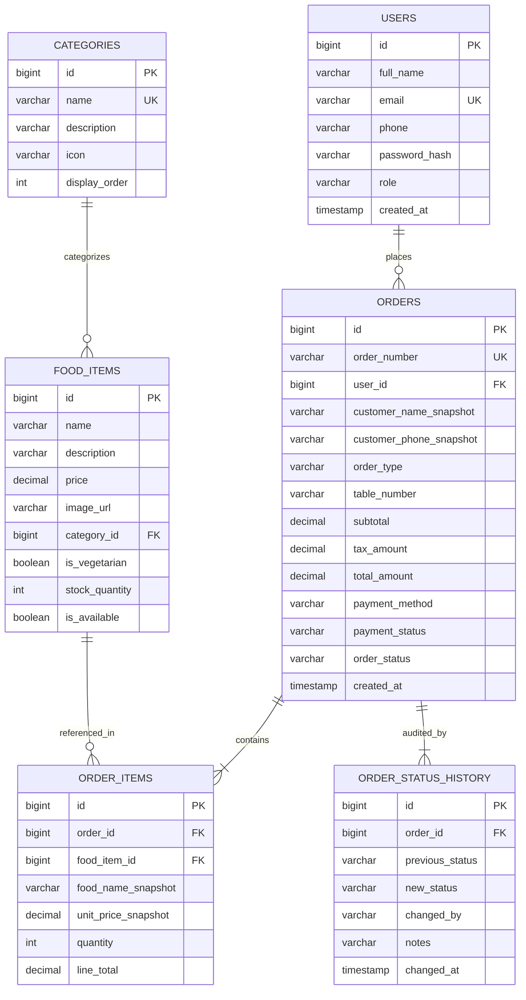

# Smart Canteen Ordering System
## Full-Stack Java Web Application (Spring Boot 3, Spring Security, JPA & MySQL)

[](https://openjdk.org/)
[](https://spring.io/projects/spring-boot)
[](https://www.mysql.com/)
[](https://spring.io/projects/spring-security)
[]()

---

## 1. Project Title and Overview

The **Smart Canteen Ordering System** is a production-grade, full-stack Java web application designed to automate college canteen and campus food court operations. Built with a robust **Spring Boot 3** backend and a responsive, modern frontend, it enables students, professors, and campus staff to browse daily food menus, add items to a digital tray, place dine-in or takeaway orders, and track preparation status in real-time using unique digital pickup tokens.

Canteen administrators and kitchen managers have access to a dedicated, password-protected **Admin Dashboard** featuring live sales revenue statistics, Chart.js trend visualizations, menu inventory management (with real-time stock deductions and restock toggles), live order progression controls, and exportable financial CSV audit reports.

---

## 2. Problem Statement

In typical college canteens and university cafeterias:
1. **Long Queues During Peak Hours:** 15–30 minute lecture breaks force hundreds of students to crowd around food counters simultaneously.
2. **Order Errors & Miscommunication:** Manual verbal orders lead to wrong food preparation, incorrect billing, and lost receipts.
3. **No Real-Time Stock Visibility:** Students often wait in line only to discover that their chosen meal or snack has sold out.
4. **Kitchen Bottlenecks:** Canteen staff lack a centralized queue console showing pending, cooking, and ready-to-collect food orders.
5. **Lack of Sales Records:** Cash collections and daily revenue are rarely tracked systematically with GST compliance.

---

## 3. Project Objectives

- **Eliminate Queue Waiting Times:** Enable students to browse foods and place orders digitally.
- **Accurate Token-Based Fulfillment:** Automatically generate sequential pickup tokens (`SCO-YYYYMMDD-XXXX`) for counter collection.
- **Atomic Inventory Control:** Deduct item stock quantities automatically upon checkout and restore inventory upon order cancellation.
- **Role-Based Security:** Separate public/student access from administrative operations via Spring Security and BCrypt password encryption.
- **Live Order Tracking:** Provide a 5-step visual stepper (`PLACED` ➔ `CONFIRMED` ➔ `PREPARING` ➔ `READY_FOR_PICKUP` ➔ `COMPLETED`).
- **Comprehensive Viva & Exam Readiness:** Provide a clean, modular Model-View-Controller (MVC) and REST layered architecture suitable for academic project evaluation.

---

## 4. Key Features

### A. Customer (Student & Staff) Features
- **User Authentication:** Secure registration and login with email uniqueness validation and BCrypt password hashing.
- **Interactive Food Menu:** Browse 25+ authentic Indian canteen foods across 7 categories (Breakfast, Meals, Rice & Biryani, Snacks, Fast Food, Beverages, Desserts).
- **Search & Filter:** Instant search by keyword, filter by category pill, toggle **Pure Veg / Non-Veg**, and sort by price or name.
- **Persistent Digital Cart:** Persistent client-side cart that recalculates subtotals, applies 5% GST itemization, and calculates the total.
- **Flexible Checkout:** Choose between **Dine-In** (with Table Number input) or **Takeaway (Parcel)** with optional preparation notes.
- **Live Order Tracking:** 5-step interactive progress bar with auto-polling every 10 seconds.
- **Self-Service Order Cancellation:** Customers can cancel orders while in `PLACED` or `CONFIRMED` status, which automatically restores item stock.
- **Order History:** Complete history of active and completed orders with one-click re-tracking.

### B. Canteen Administrator Features
- **Live Analytics Dashboard:**
  - Total Orders, Today's Orders, Pending Kitchen Tokens, Today's Sales (₹), and Registered Customers.
  - 7-Day Revenue Trend Line Chart.
  - Order Status Doughnut Chart.
  - Top 5 Campus Best-Sellers Bar Chart.
- **Food Menu Management:**
  - Create new food items with price, category, veg/non-veg flag, stock count, and images.
  - Edit descriptions and pricing.
  - One-click Availability Switch (Instantly marks item as Active or Hidden).
  - Inline Inventory Adjuster (Update remaining portions in seconds).
  - Delete food items.
- **Category Management:**
  - Add and modify categories with custom icons.
  - Orphan-prevention safety (rejects category deletion if active foods depend on it).
- **Kitchen Order Console:**
  - View all orders with real-time status filtering.
  - Advance orders sequentially (`PLACED` ➔ `CONFIRMED` ➔ `PREPARING` ➔ `READY_FOR_PICKUP` ➔ `COMPLETED`).
  - View item breakdowns, customer phone numbers, table numbers, and cooking instructions.
  - Admin cancellation with automated inventory restoration.
- **Customer Management:** Directory of registered students and their past order histories without exposing passwords.
- **Financial Reports & CSV Export:**
  - Timeframe selector: Today, Past 7 Days, Past 30 Days, All Time.
  - Direct download of canteen order audit reports in standard `.csv` format.

---

## 5. Technologies Used

| Layer | Technology | Details |
| :--- | :--- | :--- |
| **Backend** | Java 21 / Spring Boot 3.3.4 | RESTful Web Services, Layered Architecture |
| **Security** | Spring Security 6 + JJWT | Stateless JWT Token Authentication, BCrypt Hashing |
| **ORM & Data** | Spring Data JPA / Hibernate | Object-Relational Mapping, HQL, Transactions |
| **Database** | MySQL 8.0+ / H2 Engine | Normalized relational tables with dual-profile support |
| **Frontend** | HTML5, CSS3, Vanilla JavaScript | Modular fetch client, Pub-Sub cart manager |
| **UI Framework** | Bootstrap 5.3 + Font Awesome 6 | Responsive grid, Offcanvas navigation, Modals |
| **Visualizations** | Chart.js 4.x | Line graphs, Doughnut charts, Horizontal bar charts |
| **Build Tool** | Apache Maven 3.9+ | Dependency management, compiler plugin release 21 |
| **Testing** | JUnit 5, Spring Boot Test | Automated unit & integration tests |

---

## 6. System Architecture

The application adopts a **Clean Layered Architecture**:

```
[ Web Browser Client ]
       │
       ▼ (HTTP / JSON + JWT)
[ Spring Security Filter Chain (JwtAuthenticationFilter) ]
       │
       ▼
[ Controller Layer (@RestController) ]
  ├── AuthController
  ├── FoodController / CategoryController
  ├── OrderController
  └── Admin Controllers (Dashboard, Foods, Orders, Reports)
       │
       ▼ (DTO Transfer)
[ Service Layer (@Service) - Transaction Boundaries (@Transactional) ]
  ├── AuthService
  ├── FoodService / CategoryService
  ├── OrderService (Atomic stock checks & tax calculation)
  ├── AdminDashboardService
  └── AdminReportService (CSV generation)
       │
       ▼ (Domain Entities)
[ Repository Layer (@Repository - Spring Data JPA) ]
  ├── UserRepository
  ├── CategoryRepository
  ├── FoodItemRepository
  ├── OrderRepository
  ├── OrderItemRepository
  └── OrderStatusHistoryRepository
       │
       ▼ (Hibernate ORM / JDBC)
[ Relational Database (MySQL 8.0+ / H2 In-Memory/File) ]
```

---

## 7. Database Schema and Relationships

The database is normalized to 3NF with foreign keys, constraints, and audit timestamps.



> **Snapshot Integrity:** Even if a menu item's price or description changes later, existing orders preserve `food_name_snapshot` and `unit_price_snapshot` for financial auditing.

---

## 8. Project Folder Structure

```
smart-canteen-system/
├── pom.xml                               # Maven project dependencies & build plugins
├── schema.sql                            # Relational MySQL DDL schema
├── data.sql                              # Seed data for MySQL Workbench
├── .env.example                          # Sample environment configuration
├── README.md                             # Comprehensive project documentation
├── src/
│   ├── main/
│   │   ├── java/com/smartcanteen/
│   │   │   ├── SmartCanteenApplication.java
│   │   │   ├── config/                   # SecurityConfig, WebConfig
│   │   │   ├── controller/               # REST API endpoints
│   │   │   ├── dto/
│   │   │   │   ├── request/              # LoginRequest, OrderCreateRequest, etc.
│   │   │   │   └── response/             # ApiResponse, OrderResponse, etc.
│   │   │   ├── entity/                   # JPA Entities (User, Order, FoodItem, etc.)
│   │   │   ├── enums/                    # Role, OrderStatus, OrderType, etc.
│   │   │   ├── exception/                # GlobalExceptionHandler & Custom Exceptions
│   │   │   ├── repository/               # Spring Data JPA Repositories
│   │   │   ├── security/                 # JwtTokenProvider, CustomUserDetails
│   │   │   ├── service/                  # Business Logic & Transactional services
│   │   │   └── util/                     # DataInitializer (auto-seeds 26 items)
│   │   └── resources/
│   │       ├── application.properties    # Main configuration & active profile
│   │       ├── application-dev.properties# Embedded database profile (Zero setup)
│   │       ├── application-mysql.properties # MySQL production database profile
│   │       └── static/                   # Served directly by Spring Boot
│   │           ├── index.html            # Landing / Home page
│   │           ├── menu.html             # Interactive food menu
│   │           ├── cart.html             # Shopping cart page
│   │           ├── checkout.html         # Checkout & dining option page
│   │           ├── order-confirmation.html # Token receipt page
│   │           ├── order-tracking.html   # Live 5-step order tracking
│   │           ├── my-orders.html        # Customer orders history
│   │           ├── login.html            # Sign in page (with demo auto-fill)
│   │           ├── register.html         # Student registration page
│   │           ├── admin-dashboard.html  # Admin KPI & Chart.js dashboard
│   │           ├── admin-foods.html      # Menu & stock management
│   │           ├── admin-categories.html # Category management
│   │           ├── admin-orders.html     # Kitchen order token console
│   │           ├── admin-customers.html  # Customer account directory
│   │           ├── admin-reports.html    # Financial summary & CSV export
│   │           ├── css/                  # style.css, admin.css
│   │           ├── js/                   # api.js, auth.js, cart.js, menu.js, admin.js
│   │           └── images/               # logo.svg, food-placeholder.svg
│   └── test/java/com/smartcanteen/       # Automated JUnit 5 integration tests
```

---

## 9. Software Prerequisites

- **Java Development Kit (JDK):** Java 21 or later (compatible with Java 21 LTS and higher).
- **Apache Maven:** Version 3.9+ (or use the configured Maven binaries).
- **Database:**
  - Option A (Zero Setup): Built-in file-backed engine running in MySQL compatibility mode (Default profile: `dev`).
  - Option B (Standard MySQL): MySQL Server 8.0+ running on `localhost:3306`.
- **Browser:** Modern web browser (Chrome, Edge, Firefox, or Safari).

---

## 10. Database Setup Instructions

### Option A: Out-of-the-Box Zero-Setup Mode (Default)
The application comes pre-configured with a file-backed database in MySQL compatibility mode. It saves records under `./data/canteen_db` so data persists across restarts. **No database installation is required** to run and grade this project.

### Option B: Local MySQL Server Setup
1. Open **MySQL Workbench** or your terminal:
   ```sql
   CREATE DATABASE smart_canteen_db;
   ```
2. (Optional) Run `schema.sql` and `data.sql` included in the project root:
   ```bash
   mysql -u root -p smart_canteen_db < schema.sql
   mysql -u root -p smart_canteen_db < data.sql
   ```
3. Open [src/main/resources/application.properties](file:///Users/sarranbs/Desktop/Java%20PBL/src/main/resources/application.properties) and switch the active profile:
   ```properties
   spring.profiles.active=mysql
   ```
4. Verify your MySQL username and password in [src/main/resources/application-mysql.properties](file:///Users/sarranbs/Desktop/Java%20PBL/src/main/resources/application-mysql.properties):
   ```properties
   spring.datasource.url=jdbc:mysql://localhost:3306/smart_canteen_db?createDatabaseIfNotExist=true&useSSL=false&allowPublicKeyRetrieval=true&serverTimezone=Asia/Kolkata
   spring.datasource.username=root
   spring.datasource.password=your_password
   ```

---

## 11. Initial Admin & Student Credentials

When the application boots for the first time, `DataInitializer.java` automatically seeds:
- **Default Administrator Account:**
  - **Email:** `admin@smartcanteen.com`
  - **Password:** `Admin@123`
  - **Role:** `ROLE_ADMIN`
- **Demo Student Account:**
  - **Email:** `student@smartcanteen.com`
  - **Password:** `Student@123`
  - **Role:** `ROLE_CUSTOMER`
- **26 Indian Canteen Food Items:** Spanning Breakfast, Meals, Biryanis, Snacks, Beverages, and Desserts with realistic INR prices and initial stock.

> **Viva Tip:** On the login page (`/login.html`), click **"Auto-fill Demo Student"** or **"Auto-fill Demo Admin"** to test immediately without typing.

---

## 12. How to Build and Run the Project

### Building and Running via Terminal

#### macOS / Linux:
```bash
# 1. Clone or navigate to the project directory
cd "smart-canteen-system"

# 2. Run automated test suite
mvn test

# 3. Start the Spring Boot application
mvn spring-boot:run
```

#### Windows (Command Prompt / PowerShell):
```cmd
cd smart-canteen-system
mvn test
mvn spring-boot:run
```

To run with MySQL profile directly:
```bash
mvn spring-boot:run -Dspring-boot.run.profiles=mysql
```

---

## 13. How to Access the Website

Once the terminal outputs `Tomcat started on port 8080 (http)`:

- **Customer Website (Home Page):** [http://localhost:8080/](http://localhost:8080/)
- **Food Menu:** [http://localhost:8080/menu.html](http://localhost:8080/menu.html)
- **Shopping Cart:** [http://localhost:8080/cart.html](http://localhost:8080/cart.html)
- **Sign In / Registration:** [http://localhost:8080/login.html](http://localhost:8080/login.html)
- **Customer Orders:** [http://localhost:8080/my-orders.html](http://localhost:8080/my-orders.html)
- **Admin Dashboard:** [http://localhost:8080/admin-dashboard.html](http://localhost:8080/admin-dashboard.html)
- **H2 Database Console:** [http://localhost:8080/h2-console](http://localhost:8080/h2-console) (JDBC URL: `jdbc:h2:file:./data/canteen_db`, User: `sa`, Password: *blank*)

---

## 14. Testing Customer and Admin Workflows

### Workflow 1: Customer Order Placement
1. Visit [http://localhost:8080/menu.html](http://localhost:8080/menu.html).
2. Filter by **"Breakfast"** and click **"Add"** on *Masala Dosa* and *Filter Coffee*.
3. Click the **Cart badge** in the navbar to open [cart.html](file:///Users/sarranbs/Desktop/Java%20PBL/src/main/resources/static/cart.html). Notice the transparent 5% GST itemization.
4. Click **"Proceed to Checkout"**.
5. Click **"Auto-fill Demo Student"** on the login page and sign in.
6. Select **Dine-In** and enter Table Number `T-08`.
7. Click **"Confirm & Place Order"**.
8. Notice the instant generation of token `SCO-YYYYMMDD-XXXX` and redirect to the **Live Order Tracking** page with the active progress stepper.

### Workflow 2: Admin Kitchen Progression & CSV Export
1. Visit [http://localhost:8080/login.html](http://localhost:8080/login.html) and click **"Auto-fill Demo Admin"** (`admin@smartcanteen.com` / `Admin@123`).
2. You are redirected to the **Admin Dashboard** ([admin-dashboard.html](file:///Users/sarranbs/Desktop/Java%20PBL/src/main/resources/static/admin-dashboard.html)). Review the revenue counters and Chart.js graphs.
3. Open **Orders** ([admin-orders.html](file:///Users/sarranbs/Desktop/Java%20PBL/src/main/resources/static/admin-orders.html)).
4. Locate the newly placed token. Use the status dropdown to advance the order from `PLACED` ➔ `CONFIRMED` ➔ `PREPARING` ➔ `READY_FOR_PICKUP` ➔ `COMPLETED`.
5. Open **Sales Reports** ([admin-reports.html](file:///Users/sarranbs/Desktop/Java%20PBL/src/main/resources/static/admin-reports.html)) and click **"Export CSV"**. A formatted audit file will download to your machine.

---

## 15. REST API Documentation

### Public & Authentication Endpoints
- `POST /api/auth/register` - Create customer account.
- `POST /api/auth/login` - Authenticate and receive JWT Bearer token.
- `GET /api/auth/me` - Get logged-in user profile *(Protected)*.
- `PUT /api/auth/profile` - Update profile name, phone, or password *(Protected)*.
- `GET /api/categories` - List all food categories with item counts.
- `GET /api/foods` - List foods with optional query parameters (`categoryId`, `isVeg`, `availableOnly`, `search`, `sortBy`).
- `GET /api/foods/{id}` - Get detailed food item attributes.

### Customer Endpoints *(Requires CUSTOMER or ADMIN)*
- `POST /api/orders` - Place order with atomic stock validation and price recalculation.
- `GET /api/orders/my` - Get current customer's order history.
- `GET /api/orders/{id}` - View order details *(Ownership enforced)*.
- `GET /api/orders/number/{orderNumber}` - View order details by token number *(Ownership enforced)*.
- `POST /api/orders/{id}/cancel` - Cancel order and restore stock *(Permitted only when PLACED or CONFIRMED)*.

### Admin Endpoints *(Requires ROLE_ADMIN)*
- `GET /api/admin/dashboard/stats` - Aggregate KPI metrics, 7-day sales points, status distribution.
- `GET /api/admin/orders` - Paginated orders with status and date filters.
- `PATCH /api/admin/orders/{id}/status` - Advance order status with business validation.
- `POST /api/admin/orders/{id}/cancel` - Cancel order and restore inventory.
- `POST /api/admin/foods` - Add new food item to menu.
- `PUT /api/admin/foods/{id}` - Update food item details.
- `DELETE /api/admin/foods/{id}` - Remove food item.
- `PATCH /api/admin/foods/{id}/availability?available=true/false` - Toggle food visibility.
- `PATCH /api/admin/foods/{id}/stock` - Update inventory count.
- `POST /api/admin/categories` - Create new category.
- `PUT /api/admin/categories/{id}` - Update category.
- `DELETE /api/admin/categories/{id}` - Delete category (Orphan protection enforced).
- `GET /api/admin/customers` - List customer accounts.
- `GET /api/admin/reports/sales?period=TODAY|WEEK|MONTH|ALL` - Financial audit report.
- `GET /api/admin/reports/orders/export-csv?period=TODAY` - Download `.csv` spreadsheet.

---

## 16. Troubleshooting Common Issues

1. **Port 8080 already in use:**
   - Terminate the process holding port 8080:
     - On Mac/Linux: `lsof -ti :8080 | xargs kill -9`
     - On Windows: `netstat -ano | findstr :8080` then `taskkill /PID <PID> /F`
   - Alternatively, edit `server.port=8081` in [src/main/resources/application.properties](file:///Users/sarranbs/Desktop/Java%20PBL/src/main/resources/application.properties).
2. **Access Denied on Admin Endpoints:**
   - Make sure you log in with an account having `ROLE_ADMIN` (`admin@smartcanteen.com`).
3. **Cannot connect to MySQL database:**
   - Verify that your MySQL server daemon is running.
   - Or simply keep `spring.profiles.active=dev` in `application.properties` to use the zero-setup embedded database.

---

## 17. Viva Voce Preparation Guide (Questions & Answers)

- **Q: Why use BCrypt instead of MD5 or SHA-256 for passwords?**
  - *A:* BCrypt incorporates a salt to protect against rainbow table attacks and is an adaptive hash function with a configurable work factor, making brute-force attacks computationally infeasible.
- **Q: How does the system prevent overselling under concurrent orders?**
  - *A:* Checkout runs inside a Spring `@Transactional` boundary. Food inventory is verified against `stockQuantity` and atomically decremented before the order entity is persisted.
- **Q: Why store snapshots of food names and prices in `order_items`?**
  - *A:* If a canteen manager later changes the price of *Masala Dosa* from ₹60 to ₹70, past invoices must retain the ₹60 price that the customer was actually billed.
- **Q: How is Insecure Direct Object Reference (IDOR) prevented?**
  - *A:* When a customer requests `/api/orders/{id}`, `OrderService` verifies that `order.getUser().getId()` matches the authenticated user ID extracted from the verified JWT. Customers cannot inspect other students' orders.

---

## 18. Conclusion

The **Smart Canteen Ordering System** bridges the gap between campus culinary services and modern student life. By replacing crowded queues with transparent, digital order tokens, automated stock tracking, and secure administrative controls, it provides a functional, production-ready solution that demonstrates full-stack Java engineering principles.
